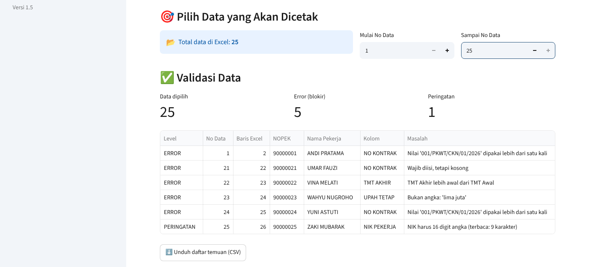
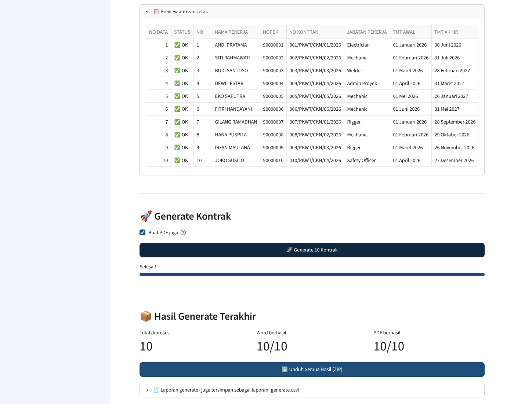
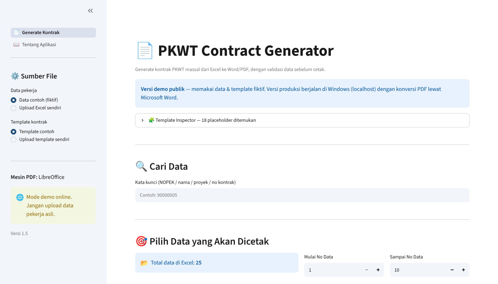
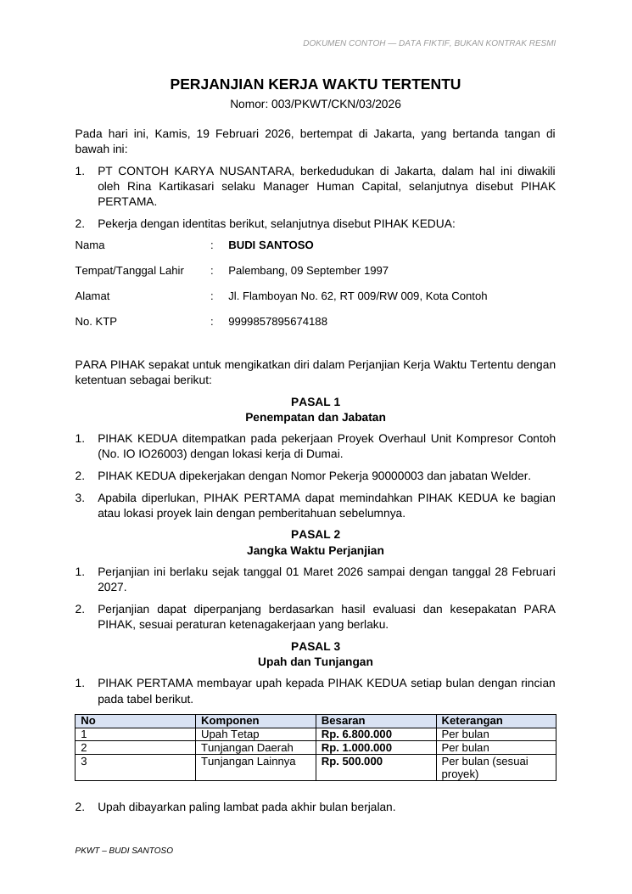
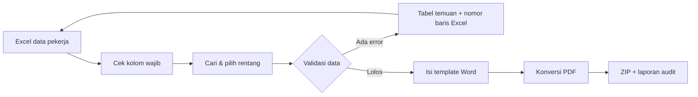

# 📄 PKWT Contract Generator

<!-- Ganti LINK_DEMO dan LINK_VIDEO setelah deploy & upload video (lihat PANDUAN_PORTOFOLIO.md) -->
[](LINK_DEMO)
&nbsp; 🎬 [Video Demo (2 menit)](LINK_VIDEO)

> **Overview (EN):** An internal HR tool that bulk-generates fixed-term employment contracts (PKWT)
> from an Excel sheet into Word and PDF. It validates every record *before* printing — blocking
> missing contract numbers, reversed contract dates, non-numeric salaries and duplicate contract
> numbers — so errors are caught on screen instead of on a signed contract.
> Built with Python & Streamlit by an HR Database officer, not a software team.

Aplikasi internal HR untuk membuat **kontrak PKWT secara massal** dari data Excel ke Word dan PDF,
dengan **validasi data sebelum cetak**.

---

## 🧩 Masalah yang Diselesaikan

| Sebelum | Sesudah |
|---|---|
| Kontrak dibuat satu per satu: salin data Excel → tempel ke Word → simpan → export PDF | Puluhan kontrak dibuat sekali klik |
| Salah nomor kontrak / tanggal / upah baru ketahuan setelah dicetak | Data salah **diblokir** sebelum generate, lengkap dengan nomor baris Excel-nya |
| Nama file tidak seragam, sulit dicari | Nama file otomatis `NOPEK_NAMA_PEKERJA.pdf` |
| Tidak ada catatan kontrak mana yang gagal | Laporan `laporan_generate.csv` + log untuk setiap proses |

## ✨ Fitur Utama

- **Validasi data otomatis**
  - Kolom wajib kosong (No Kontrak, Nama, NOPEK, TMT, Upah) → *Error, generate diblokir*
  - Upah/tunjangan bukan angka → *Error*
  - TMT Akhir lebih awal dari TMT Awal → *Error*
  - No Kontrak dobel dalam satu batch → *Error*
  - NIK tidak 16 digit, NOPEK dobel, kolom opsional kosong → *Peringatan*
- **Pencarian & pilih rentang data** — cetak sebagian data tanpa mengedit Excel
- **Template Inspector** — mendeteksi placeholder salah ketik di template Word
- **Generate massal Word + PDF**, satu dokumen gagal tidak menghentikan yang lain
- **Unduh hasil dalam satu ZIP**, plus laporan audit per proses
- Format otomatis: angka → `Rp. 6.800.000`, tanggal Excel → `01 Maret 2026`

## 🖼️ Tampilan

| Validasi memblokir data yang salah | Preview & hasil generate |
|---|---|
|  |  |

| Halaman utama | Contoh kontrak yang dihasilkan |
|---|---|
|  |  |

## 🔄 Alur Kerja



## 🗂️ Struktur Folder

```
pkwt-contract-generator/
├── app.py                     # Pintu masuk & menu halaman
├── views/                     # Tampilan (UI Streamlit)
│   ├── generate_kontrak.py
│   └── tentang_aplikasi.py
├── services/                  # Logika proses (tanpa kode UI)
│   ├── excel_service.py       # Baca Excel, cari, pilih rentang
│   ├── validation_service.py  # Aturan validasi data
│   ├── document_service.py    # Isi template Word + Template Inspector
│   ├── pdf_service.py         # Konversi PDF (Word / LibreOffice)
│   └── generate_service.py    # Proses massal, laporan, ZIP
├── utils/
│   ├── formatters.py          # Rupiah, tanggal Indonesia, nama file
│   └── logger.py              # Log ke logs/app.log
├── config/settings.py         # Semua pengaturan & pemetaan kolom
├── data/                      # Excel contoh (fiktif)
├── templates/                 # Template kontrak contoh (generik)
├── scripts/                   # Pembuat ulang data & template contoh
├── docs/screenshots/
├── output/                    # Hasil generate (tidak di-upload ke GitHub)
└── logs/                      # File log (tidak di-upload ke GitHub)
```

## 🚀 Cara Menjalankan (Windows)

Prasyarat: Python 3.12, dan Microsoft Word jika ingin hasil PDF.

```bash
python -m venv .venv
.venv\Scripts\activate
pip install -r requirements.txt
streamlit run app.py
```

Browser akan terbuka di `http://localhost:8501`.

## 📋 Format Excel

Baris pertama berisi judul kolom berikut (huruf besar/kecil dan spasi berlebih tidak masalah):

`NO`, `NO KONTRAK`, `WAKTU PEMBUATAN KONTRAK`, `MANAGER`, `NAMA PEKERJA`, `TTL PEKERJA`,
`ALAMAT PEKERJA`, `NIK PEKERJA`, `NAMA PROYEK`, `NO IO PROYEK`, `NOPEK`, `JABATAN PEKERJA`,
`TMT AWAL`, `TMT AKHIR`, `UPAH TETAP`, `TUNJANGAN DAERAH`, `TUNJANGAN LAINNYA`,
`LOKASI KERJA`, `NAMA BAWAH`

Lihat contoh lengkap di [`data/contoh_data_pekerja.xlsx`](data/contoh_data_pekerja.xlsx).
Data nomor 21–25 **sengaja dibuat salah** untuk memperlihatkan fitur validasi.

Template Word memakai placeholder seperti `{{ NAMA_PEKERJA }}` dan `{{ TMT_AWAL }}`;
pemetaan lengkapnya ada di [`config/settings.py`](config/settings.py).

## 🌐 Versi Demo vs Versi Produksi

| | Produksi (kantor) | Demo online |
|---|---|---|
| Lokasi | Laptop HR, Windows, localhost | Streamlit Community Cloud |
| PDF | Ya, lewat Microsoft Word | Tidak (server tanpa Word) → hasil berupa Word |
| Data | Data pekerja asli | **Data & template fiktif** |

Aplikasi mendeteksi sistem operasinya sendiri, jadi kode yang sama berjalan di kedua tempat.

## 🛣️ Roadmap

- [x] Validasi data & Template Inspector
- [x] Logging & laporan audit per proses
- [ ] Riwayat generate (SQLite lokal)
- [ ] Dashboard monitoring masa kontrak (kontrak yang akan berakhir)
- [ ] Alur persetujuan (approval) & tanda tangan digital

## 👤 Pengembang

**Fadhillah Al Faruq** — HC Officer, Recruitment & Database.
Dibangun untuk menyelesaikan pekerjaan administrasi HR yang berulang, dengan prinsip:
sederhana, mudah dirawat, dan fokus pada akurasi data.

> Seluruh nama, NIK, perusahaan, proyek, dan isi template di repository ini adalah **fiktif**
> dan dibuat khusus untuk demonstrasi.
